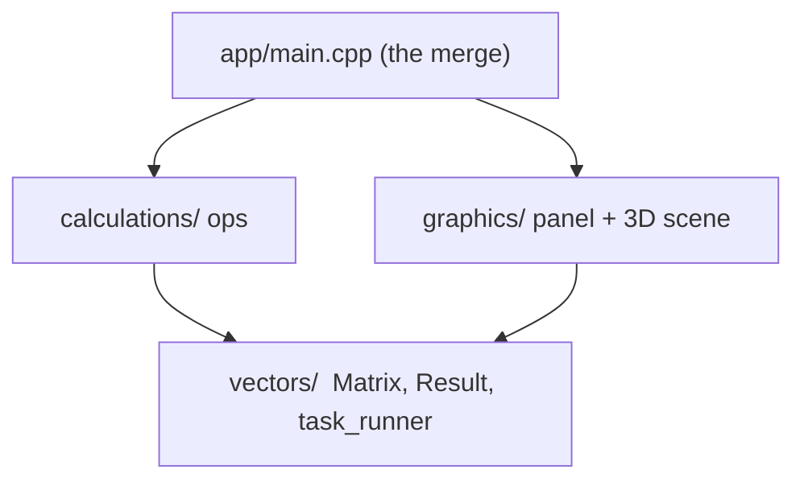
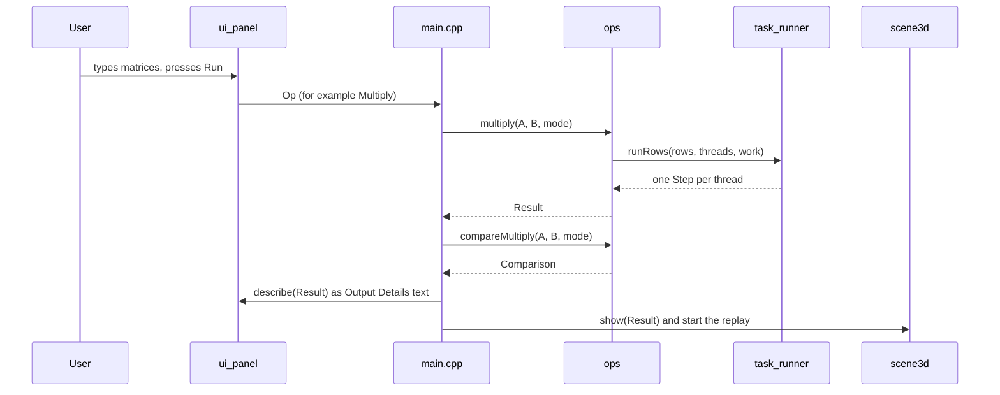

# Matrix Lab

A desktop matrix calculator that **shows** how matrix operations work and how parallel computing splits the work. Type two 3x3 matrices, pick an operation, and the app explains the answer in words, with your real numbers, and replays it as an animated 3D scene where each matrix column is an arrow and the box they span is the determinant.

Written in C++17 with [raylib](https://www.raylib.com/) (window, 3D) and [raygui](https://github.com/raysan5/raygui) (buttons, text boxes).

<!-- Add a screenshot or GIF here once you have one:

-->

## What it does

- **Operations:** add, subtract, multiply, transpose, determinant, inverse.
- **Output Details** explains every result in sections:
  - **WHY:** a plain-language reason the operation works.
  - **HOW:** worked lines with your numbers, for example `C[2][1] = 4*2 + 5*1 + 6*1 = 19 [thread 1]`.
  - **THREADS:** which thread computed which rows, and how long each took.
  - **COMPARISON:** the same multiplication on 1 thread versus many, with the measured speedup.
- **3D view** (3x3 matrices): the matrix columns are arrows, the box they span is the shape the matrix makes from the unit cube. You can replay, pause and scrub through the animation.
- **Two threading modes** for multiplication: one thread per row (to see threads) or all CPU cores (to see speed).

## Concepts behind it

### 1. Matrices as arrows and boxes

A 3x3 matrix has three columns. Each column is a 3D arrow from the origin, and it tells you where the x, y and z axes end up after the matrix is applied. The three arrows span a box (a parallelepiped). The unit cube is the box you get from the identity matrix.

| Operation | What the 3D view shows |
|---|---|
| **A + B** / **A - B** | The B arrows slide to the tips of the A arrows. The sum (or difference) is the arrow from the origin to the new tip. |
| **A x B** | B moves the unit cube first, then A moves it again. The thread lanes fill as each row of the answer finishes. |
| **transpose** | Rows become columns: the arrows morph into the transposed matrix's arrows. |
| **determinant** | The box grows from the unit cube, and its signed volume is shown live. A negative volume means the box is mirrored (drawn red). A volume of 0 means the box is flat. |
| **inverse** | The box returns to the unit cube, which is what "undoing" the matrix means. It exists only when the determinant is not 0, because a flat box cannot be un-flattened. |

### 2. Data parallelism: splitting matrix multiplication by rows

Cell `(i, j)` of `A x B` is row `i` of A multiplied with column `j` of B and summed up. The key observation: **a row of the answer never needs another row of the answer.** So the rows can be computed independently, in any order, at the same time.

```cpp
// src/calculations/ops.cpp (simplified)
for (i = first; i < last; ++i)            // this thread's rows only
    for (k = 0; k < a.cols(); ++k)
        for (j = 0; j < b.cols(); ++j)
            out(i, j) += a(i, k) * b(k, j);
```

`runRows` in `src/vectors/task_runner.h` cuts the row range into contiguous chunks and runs one chunk per `std::thread` (the first chunk runs on the calling thread). It records a `Step` for every chunk: thread number, row range, and milliseconds.

| Mode | Threads used | Purpose |
|---|---|---|
| **1 task per row** (demo) | One per row of A, capped at 64 | Makes each row visibly a thread. |
| **All cores** | `std::thread::hardware_concurrency()` | The realistic setting for big matrices. |

### 3. Why there are no locks

Every thread writes to **its own rows** of the result and only *reads* A and B. Nothing is written by two threads, so there is no data race and no mutex is needed. The only synchronisation is `join()`, which waits for every thread to finish before the result is used. That join is the "merge" step in the design.

### 4. When threads help, and when they do not

Starting and joining a thread costs microseconds. A 3x3 multiplication takes nanoseconds. So on small matrices threads are **slower**, and the COMPARISON section says so honestly. Threads win when the arithmetic is large enough to pay for them (roughly hundreds of rows and up, depending on your CPU).

The comparison times the same multiplication on 1 thread and on the chosen mode, repeated up to 300 times and averaged, because a single run of a tiny multiplication is too short to measure reliably.

### 5. Cache-friendly loop order

The inner loops run in `i-k-j` order so the innermost loop walks along a row of `B` and a row of the result, which sit next to each other in memory (matrices are stored row-major in one flat array). The textbook `i-j-k` order jumps down a column of `B` and is slower on large matrices.

### 6. Determinant and inverse

Both use Gaussian elimination with **partial pivoting**: at each step the row with the largest number in the current column is swapped in, which keeps rounding errors small. Each row swap flips the sign of the determinant. The inverse uses Gauss-Jordan elimination on `[A | I]`, and the output reports `max |A x inverse - I|` as a check on the result. A "pivot is zero" test is scaled to the size of the numbers in the matrix, so a singular matrix is reported as such instead of producing garbage.

### 7. How the thread animation relates to real time

The real work takes microseconds, which is too fast to see. The animation therefore plays at a fixed speed, and the **relative** lane lengths come from the measured thread times (the slowest thread fills its lane completely, faster ones finish earlier, never under 35% so they stay visible). The thread panel is labelled "animation speed, not real time". The real timings are in the Output Details.

## Architecture

The code is split into three layers, plus a thin `app` that connects them. The two big layers never depend on each other.



| Folder | Role |
|---|---|
| `src/vectors/` | Data and threads. `Matrix` (flat row-major array), `Result` (answer + why + how + steps + timing) and `task_runner.h` (splits rows across threads). Depends on nothing. |
| `src/calculations/` | The maths: `add`, `subtract`, `transpose`, `multiply`, `determinant`, `inverse`, and `compareMultiply`. Each returns a `Result`. No graphics code. |
| `src/graphics/` | `ui_panel` (left half: grids, buttons, Output Details), `scene3d` (right half: 3D drawing), `scene_math.h` (pure geometry for the animation, no raylib), `theme` (font loading). Never calls `calculations`. |
| `src/app/main.cpp` | The only file that knows both sides exist. Takes the user's request from the panel, runs the calculation, and hands the same `Result` to the panel and the 3D scene. |

Because `Result` is the single shared language, the text, the thread numbers and the 3D picture are always about the same calculation.

### What happens when you press Run



## Getting started

### What you need

| Tool | Version | Notes |
|---|---|---|
| **C++ compiler** | C++17 | MinGW-w64 g++ (UCRT, posix threads) or MSVC on Windows; g++ or clang on Linux/macOS. MinGW builds must have thread support (`posix`, not `win32` threads). |
| **CMake** | 3.14 or newer | Tested with 4.x. |
| **Git** | any | CMake uses it to download raylib and raygui. |
| **Internet** | first build only | raylib 5.5 and raygui 4.0 are downloaded into `build/`. |

On **Linux** raylib also needs the X11 and OpenGL development packages. On Debian/Ubuntu:
```bash
sudo apt install build-essential cmake git libx11-dev libxrandr-dev libxinerama-dev libxcursor-dev libxi-dev libgl1-mesa-dev
```

### Build and run (Windows, MinGW)

From the repository folder in PowerShell:
```powershell
cmake -S . -B build -G "MinGW Makefiles"
cmake --build build
.\build\matrixlab.exe
```

### Build and run (Linux / macOS)
```bash
cmake -S . -B build
cmake --build build
./build/matrixlab
```

### Run the tests
```bash
ctest --test-dir build --output-on-failure
```
There are two test programs, neither of which opens a window:
- `test_ops`: every operation gives the right answer, both thread modes match a plain loop exactly, and wrong shapes are rejected.
- `test_scene`: what the 3D scene draws agrees with what was calculated (for example, the final box volume equals the determinant).

### If something goes wrong

| Problem | Fix |
|---|---|
| `Could not resolve host: github.com` or `Connection was reset` during configure | Network problem. Check `git ls-remote https://github.com/raysan5/raylib.git`, turn off any VPN, and retry. |
| Still cannot download | Download the [raylib 5.5](https://github.com/raysan5/raylib/archive/refs/tags/5.5.zip) and [raygui 4.0](https://github.com/raysan5/raygui/archive/refs/tags/4.0.zip) zips, extract them, and run `cmake -S . -B build -G "MinGW Makefiles" -DFETCHCONTENT_SOURCE_DIR_RAYLIB=C:/deps/raylib-5.5 -DFETCHCONTENT_SOURCE_DIR_RAYGUI=C:/deps/raygui-4.0`. |
| CMake complains about an old minimum version inside raylib | Add `-DCMAKE_POLICY_VERSION_MINIMUM=3.5` to the configure command. |
| `Cannot find source file` | A file was not copied into the repo. Compare your tree with the one under [Project layout](#project-layout). |
| The text looks like a plain default font | The `assets/fonts/` folder is missing. The app still runs without it. |

## Using the app

1. Click a cell in **Matrix A** and type a number. Empty cells count as 0.
2. Press **Enter** to move to the next cell (A's last cell leads into B's first). **Tab** moves forward, **Shift+Tab** back.
3. Choose an operation in the dropdown (`A + B`, `A - B`, `A x B`) and press **Run**, or press **Ctrl+Enter**.
4. For one-matrix operations use the buttons beside each grid: **Transpose**, **Determinant**, **Inverse**.
5. Read the explanation in **Output Details** (mouse wheel scrolls it) and watch the 3D view.

| Control | Action |
|---|---|
| **Random** / **Clear** | Fill a grid with random whole numbers (-9 to 9) / empty it. |
| **Swap A<>B** | Swap the two matrices. |
| **Mode** toggle | Switch multiplication between *1 task per row* and *all cores*. |
| Drag in the 3D view | Orbit the camera. |
| Mouse wheel in the 3D view | Zoom. |
| **Replay**, **Pause / Play**, slider | Control the animation. Dragging the slider pauses it. |

### Try this
1. Fill A and B with **Random**, choose `A x B`, and press Run. Read the HOW lines, then watch the thread lanes fill.
2. Look at COMPARISON: on 3x3 the threads are slower. That is the point: parallel computing only pays off for enough work.
3. Type `1 2 3 / 4 5 6 / 7 8 9` into A and press **Determinant**. The result is 0 and the box is flat. Now press **Inverse** and read the error: a flat box has no inverse.

## Limits

- The input grids and the 3D view are **3x3 only**. The calculation layer works for any size (the tests use 40x40), but there is no UI for larger matrices yet.
- Matrix entries use plain numbers (`3`, `-2.5`), not fractions or expressions.
- The animation speed is not real time (see concept 7).
- Fixed window size of 1536 x 864.

## Roadmap

- Resizable grids (2x2 to larger) with a size slider.
- A thread-lanes view for large matrices, showing which thread computed which rows.
- A benchmark mode to find the matrix size where threads start to win on your machine.

## Project layout

```
MatrixLab/
├── CMakeLists.txt
├── README.md
├── assets/
│   └── fonts/                  JetBrains Mono (SIL Open Font License)
├── src/
│   ├── app/main.cpp            connects calculations and graphics
│   ├── calculations/           ops.h, ops.cpp
│   ├── graphics/               ui_panel, scene3d, scene_math.h, theme
│   └── vectors/                matrix.h, result.h, task_runner.h
└── test/                       test_ops.cpp, test_scene.cpp
```

## Third-party

- [raylib](https://github.com/raysan5/raylib) 5.5 and [raygui](https://github.com/raysan5/raygui) 4.0: zlib license, downloaded at build time.
- [JetBrains Mono](https://github.com/JetBrains/JetBrainsMono): SIL Open Font License 1.1 (`assets/fonts/OFL.txt`).

## License

Add a `LICENSE` file for your own code (MIT is a common choice for a project like this) and name it here.
